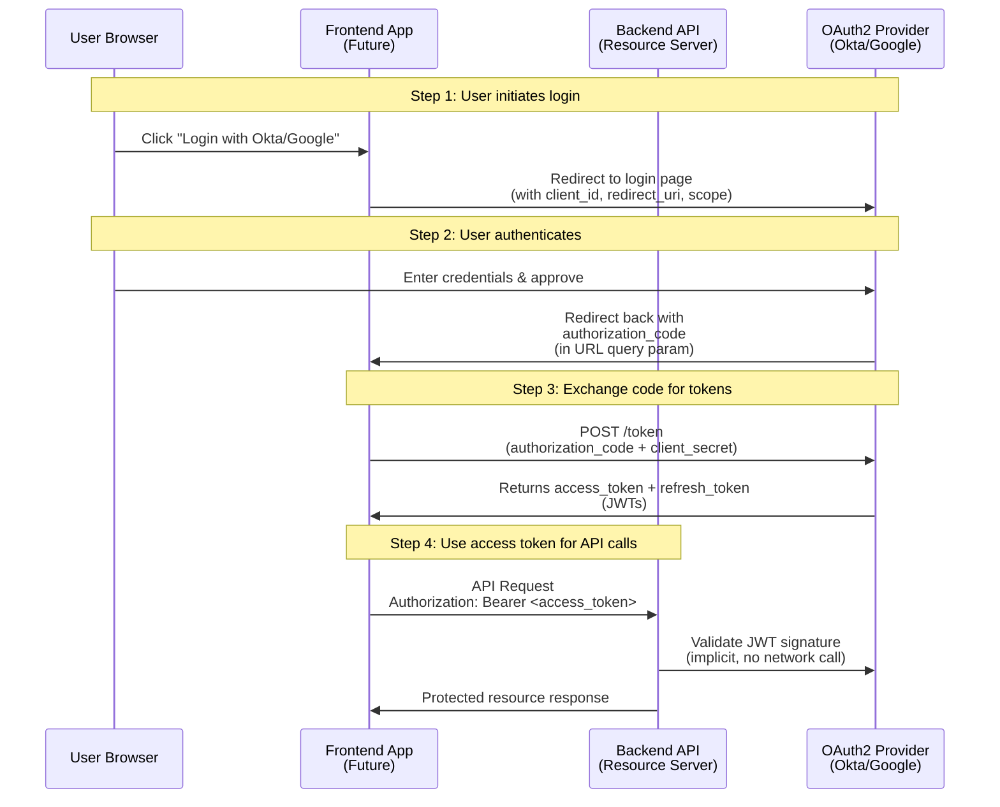
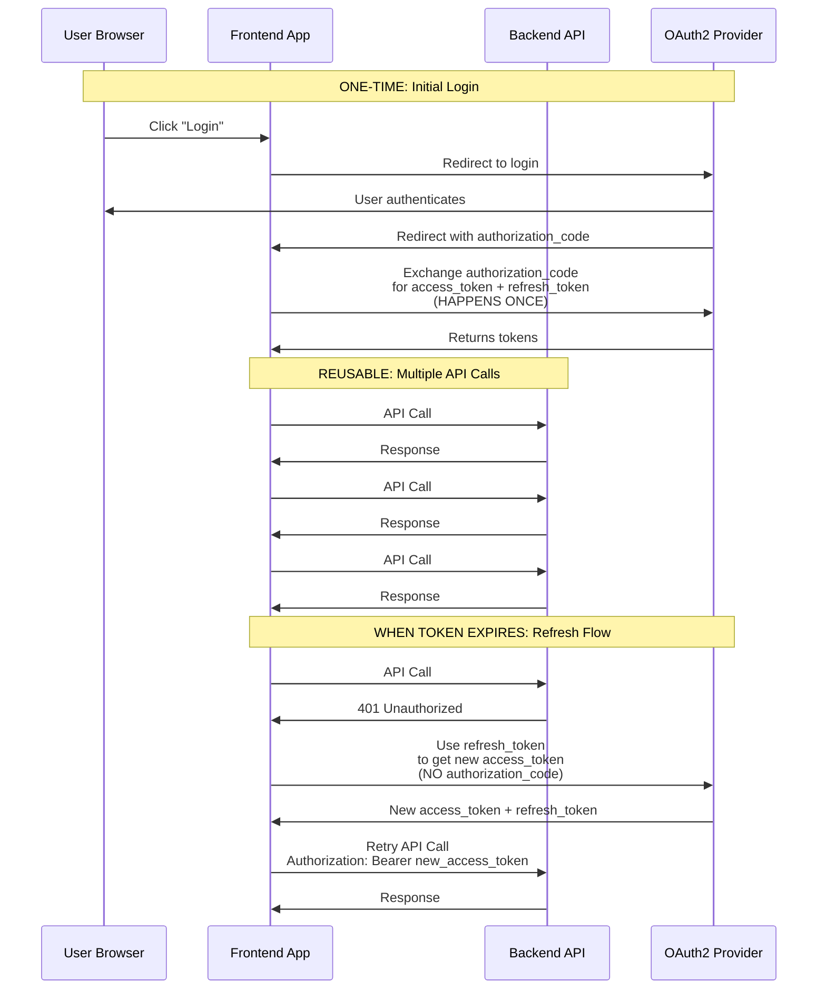
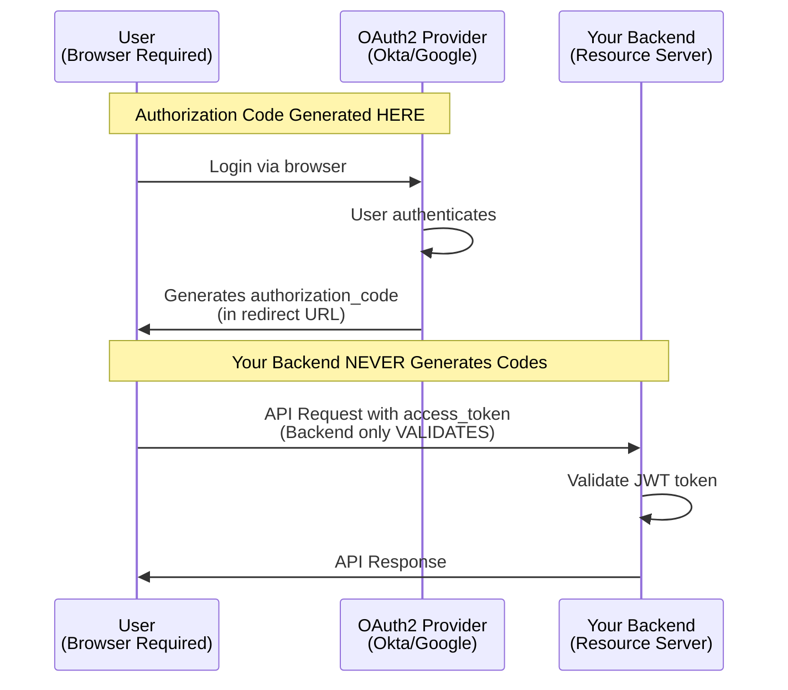
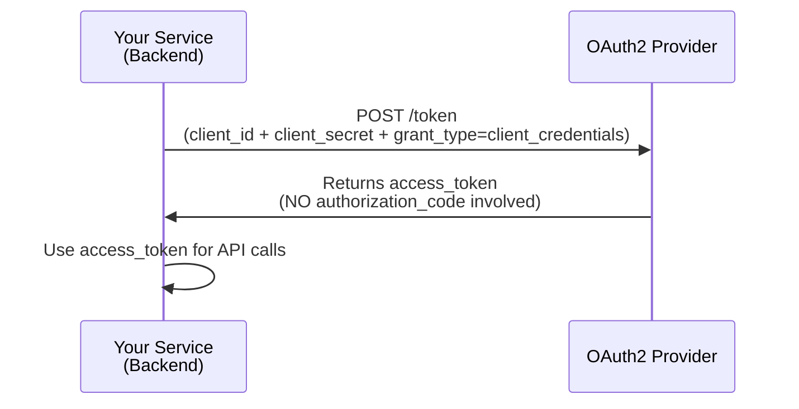
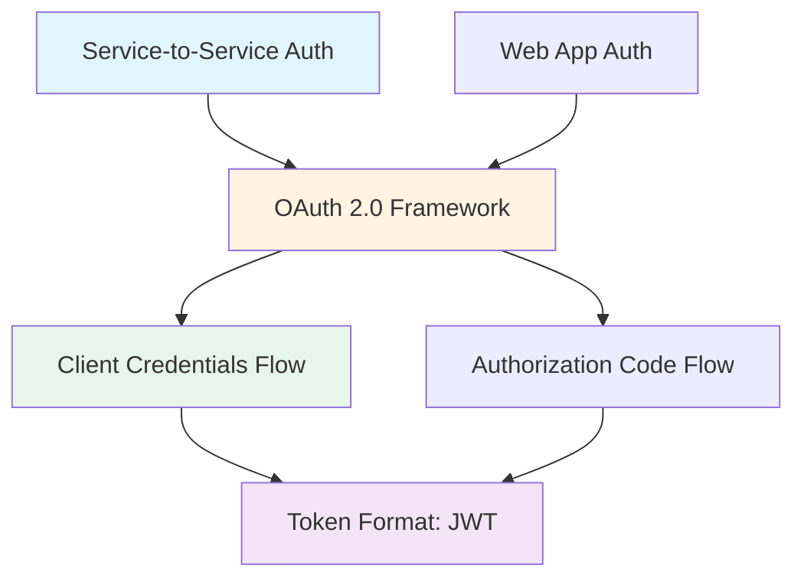
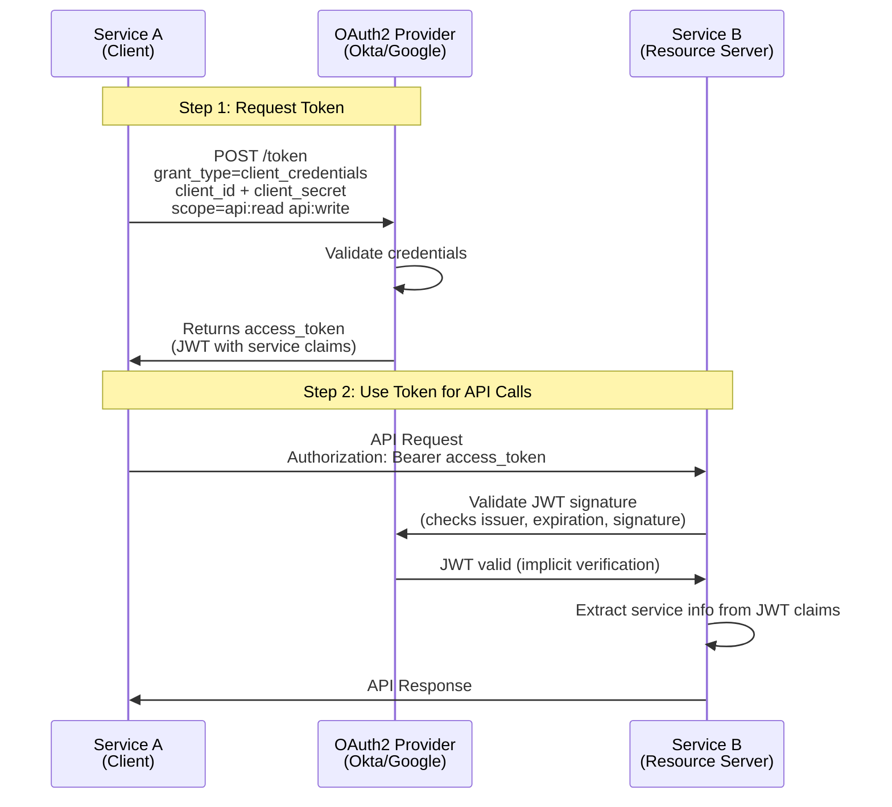

# OAuth 2.0 Concepts and Terminology Guide

## Table of Contents
1. [Authorization Code vs Access Token](#authorization-code-vs-access-token)
2. [OAuth 2.0 Flow for Frontend + Backend](#oauth-20-flow-for-frontend--backend)
3. [Backend-Only Scenarios](#backend-only-scenarios)
4. [OAuth 2.0 vs JWT Terminology](#oauth-20-vs-jwt-terminology)
5. [Service-to-Service Authentication](#service-to-service-authentication)

---

## Authorization Code vs Access Token

### Overview

These are two different components in the OAuth 2.0 flow, serving distinct purposes at different stages of authentication.

### Authorization Code

- **What**: A temporary, short-lived code (typically ~10 minutes)
- **Who has it**: Only the browser/client that initiated the login
- **Purpose**: Security token used to exchange for actual tokens
- **Security**: Must remain confidential, single-use only
- **Lifespan**: Very short-lived (typically 10 minutes, single-use)
- **Where it appears**: In the redirect URL after user logs in at the provider
- **Contains**: No user information, just a code string

### Access Token

- **What**: A JWT (JSON Web Token) or opaque token representing the user's authorization
- **Who has it**: The backend application receives it after code exchange
- **Purpose**: Used to authenticate API requests to protected resources
- **Security**: Sent in `Authorization: Bearer <token>` header
- **Lifespan**: Longer-lived (minutes to hours, reusable)
- **Where it appears**: In HTTP headers of API requests
- **Contains**: User claims (email, name, roles, etc.) if JWT format

### Flow Diagram



### Key Differences Summary

| Aspect | Authorization Code | Access Token |
|--------|-------------------|--------------|
| **Type** | Temporary code (string) | JWT token (self-contained) |
| **Lifespan** | ~10 minutes, single-use | Minutes to hours, reusable |
| **Visibility** | In browser URL (redirect) | In HTTP headers (API calls) |
| **Purpose** | Security token exchange | Authenticate API requests |
| **Who sees it** | Browser + Frontend | Frontend + Backend + Provider |
| **Contains** | No user info | User claims (email, name, etc.) |

### Why Both Exist?

The authorization code flow exists for security reasons:
1. **Code is short-lived** - Reduces risk if intercepted
2. **Code is exchanged server-side** - Access token never appears in browser URL
3. **Single-use** - Code cannot be reused if intercepted
4. **No user info in code** - Even if stolen, it's useless after expiration

---

## OAuth 2.0 Flow for Frontend + Backend

### How Authorization Code is Used (Frontend Scenario)

**Important**: The authorization code is exchanged **ONCE**, not for every API call. After exchange, the access token is reused.

### Complete Flow Timeline



### Step-by-Step Process

#### Step 1: One-Time Login (Authorization Code Exchange)

1. User clicks "Login with Okta/Google"
2. Frontend redirects to provider login page
3. User authenticates and authorizes
4. Provider redirects back with `authorization_code` in URL
5. Frontend exchanges code **once** for `access_token` + `refresh_token`
6. Authorization code is consumed (cannot be reused)
7. Tokens are stored securely (memory, httpOnly cookie, etc.)

#### Step 2: Reuse Access Token for API Calls

1. Frontend uses the **same** `access_token` for all API requests
2. Token is included in header: `Authorization: Bearer <access_token>`
3. Backend validates the token (checks signature, expiration, etc.)
4. Process repeats for every API call **using the same token**
5. Continue until token expires

#### Step 3: When Access Token Expires

1. Backend returns `401 Unauthorized`
2. Frontend uses `refresh_token` to get a new `access_token`
3. **No new authorization code needed** - refresh token handles it
4. Continue using the new `access_token` for subsequent calls
5. User only needs to login again when refresh token expires

### Timeline Example

```
Time 0:00  → User logs in
           → Frontend exchanges authorization_code → gets access_token (expires in 1 hour)
           
Time 0:01  → API Call #1 (uses access_token) ✅
Time 0:05  → API Call #2 (uses SAME access_token) ✅
Time 0:15  → API Call #3 (uses SAME access_token) ✅
Time 0:45  → API Call #4 (uses SAME access_token) ✅

Time 1:01  → API Call #5 (access_token EXPIRED) ❌
           → Backend returns 401
           → Frontend uses refresh_token → gets NEW access_token
           
Time 1:02  → API Call #5 retry (uses NEW access_token) ✅
Time 1:10  → API Call #6 (uses NEW access_token) ✅
```

### Key Takeaways

1. **Authorization code = exchanged ONCE** - Single-use, very short-lived
2. **Access token = reused many times** - Multiple API calls until expiry
3. **Refresh token = get new access tokens** - No re-login needed
4. **No re-login until refresh token expires** - Seamless user experience

### Why This Design?

- **Performance**: No repeated user interaction needed
- **Security**: Short-lived codes, reusable but revocable tokens
- **User Experience**: Login once, use many times
- **Scalability**: Token validation is fast (JWT signature verification)

---

## Backend-Only Scenarios

### Question: How is Authorization Code Generated Without Frontend?

**Answer**: Authorization codes are **NOT generated by your backend**. They are generated by the OAuth2 provider (Okta/Google) as part of the authorization flow that requires user interaction through a browser.

### Who Generates Authorization Codes?



### Why Backend Alone Cannot Generate Authorization Codes

1. **Requires browser-based user interaction** - User must login and approve
2. **Provider generates the code** - Sent via redirect URL after authentication
3. **Your backend is a Resource Server** - It only validates access tokens, doesn't participate in authorization code flow

### Options for Backend-Only Setup

#### Option 1: Client Credentials Flow (Service-to-Service)

For machine-to-machine authentication without user login:



**Characteristics:**
- No user interaction required
- Uses client credentials (client_id + client_secret)
- Direct token exchange (no authorization code)
- Suitable for backend-to-backend communication
- Tokens represent the service, not a user

#### Option 2: Manual Token Retrieval (Testing/Development)

For testing your backend without a frontend:

1. Use provider's token endpoint directly
2. Or use provider's test tools/console
3. Get access token (JWT)
4. Use it in API requests to your backend

**Example with Okta (for testing):**
```bash
# Get token directly from Okta
curl -X POST https://{okta-domain}/oauth2/default/v1/token \
  -d "grant_type=client_credentials" \
  -d "client_id=YOUR_CLIENT_ID" \
  -d "client_secret=YOUR_CLIENT_SECRET" \
  -d "scope=openid profile"

# Response: { "access_token": "eyJhbGc...", ... }

# Use token in your API calls
curl -H "Authorization: Bearer {access_token}" \
  https://your-backend/api/endpoint
```

**Example with Google (for testing):**
```bash
# Get token using service account or OAuth2 Playground
# Then use in API requests
curl -H "Authorization: Bearer {access_token}" \
  https://your-backend/api/endpoint
```

### Summary: Backend-Only Scenarios

| Scenario | Flow Type | Authorization Code? | User Interaction? |
|----------|-----------|-------------------|-------------------|
| Frontend + Backend | Authorization Code Flow | Yes (from provider) | Yes (browser) |
| Service-to-Service | Client Credentials Flow | No | No |
| Testing/Development | Direct Token Request | No | Optional (depends on method) |
| Backend Resource Server | Token Validation Only | Never sees it | N/A |

---

## OAuth 2.0 vs JWT Terminology

### Common Question

**Is service-to-service authentication using JWTs called "JWT mechanism" or is it still OAuth?**

### Answer

**It's still OAuth 2.0!** Specifically, it's the **Client Credentials Flow** of OAuth 2.0, using JWT as the token format.

### Terminology Breakdown

#### OAuth 2.0 = Authorization Framework/Protocol

- Defines the **flows** (protocols) for obtaining and using tokens
- Multiple grant types/flows:
  - Authorization Code Flow (web apps with users)
  - Client Credentials Flow (service-to-service) ← **This is what you'd use**
  - Implicit Flow (deprecated)
  - Resource Owner Password Credentials (legacy, not recommended)
  - Refresh Token Flow

#### JWT = Token Format/Standard

- **JSON Web Token** - A specific structure for tokens (header.payload.signature)
- Can be used in **many contexts**:
  - OAuth 2.0 (most common)
  - Custom authentication systems
  - API keys
  - Session tokens
  - Any system that needs self-contained tokens

### The Relationship



### Visual Explanation

```
OAuth 2.0 (Protocol)
    │
    ├── Authorization Code Flow → Uses JWT tokens
    ├── Client Credentials Flow → Uses JWT tokens ← Service-to-Service
    ├── Refresh Token Flow → Uses JWT tokens
    └── ...
```

### Key Points

1. **OAuth 2.0 is the protocol** - Defines how authentication/authorization works
2. **JWT is the token format** - How the token is structured
3. **OAuth 2.0 commonly uses JWTs** - But can also use opaque tokens
4. **Service-to-service = OAuth 2.0 Client Credentials Flow** - Still OAuth, just a different flow

### In Your Context

What you're implementing:
- **Backend as Resource Server** = OAuth 2.0 (validating JWTs issued by provider)
- **Service-to-service** = OAuth 2.0 Client Credentials Flow (using JWTs)
- **User login (future)** = OAuth 2.0 Authorization Code Flow (using JWTs)

**All of these use OAuth 2.0**, with JWT as the token format.

### Common Confusion

| What People Say | What It Actually Means |
|----------------|------------------------|
| "JWT authentication" | Usually means OAuth 2.0 with JWT tokens, or custom JWT-based auth |
| "OAuth 2.0" | The protocol/framework (token format can vary) |
| "OAuth 2.0 with JWTs" | OAuth 2.0 protocol using JWT as token format (most common) |

### Summary

- **Service-to-service auth using JWTs = OAuth 2.0** (Client Credentials Flow)
- **JWT = Token format** used by the OAuth 2.0 provider
- **Your backend = OAuth 2.0 Resource Server** that validates tokens
- **All flows = OAuth 2.0**, regardless of which flow produces the token

---

## Service-to-Service Authentication

### Overview

Service-to-service authentication is when one backend service needs to authenticate with another backend service, without user interaction.

### OAuth 2.0 Client Credentials Flow

This is the OAuth 2.0 flow designed for service-to-service communication.

### Complete Flow



### Characteristics

1. **No User Involved** - Service authenticates as itself
2. **No Authorization Code** - Direct token exchange
3. **Uses Client Credentials** - client_id + client_secret
4. **JWT Contains Service Info** - Not user info (subject = service identifier)
5. **Same Token Reuse** - Access token reused until expiration

### Token Request Example

```http
POST /oauth2/default/v1/token HTTP/1.1
Host: {okta-domain}
Content-Type: application/x-www-form-urlencoded

grant_type=client_credentials
&client_id=your_client_id
&client_secret=your_client_secret
&scope=api:read api:write
```

### Token Response

```json
{
  "access_token": "eyJhbGciOiJSUzI1NiIsImtpZCI6IjE...",
  "token_type": "Bearer",
  "expires_in": 3600,
  "scope": "api:read api:write"
}
```

### JWT Claims in Service-to-Service Token

```json
{
  "iss": "https://{provider}/oauth2/default",
  "sub": "service-client-id",
  "aud": "api://your-api",
  "exp": 1234567890,
  "iat": 1234564290,
  "scope": "api:read api:write",
  "client_id": "service-client-id"
}
```

**Note**: Claims represent the **service**, not a user (no `email`, `name`, `preferred_username`).

### Use Cases

- Microservices communication
- Scheduled jobs/cron tasks calling APIs
- Backend services accessing other backend services
- System-to-system integration
- Automated processes

### Comparison with User-Based Flow

| Aspect | Authorization Code Flow (Users) | Client Credentials Flow (Services) |
|--------|-------------------------------|-----------------------------------|
| **Who authenticates** | End user | Service/application |
| **Authorization Code** | Yes | No |
| **Credentials** | User login | client_id + client_secret |
| **Token Subject** | User identifier | Service/client identifier |
| **JWT Claims** | User info (email, name) | Service info (client_id, scopes) |
| **User Interaction** | Required | Not required |
| **Use Case** | Web apps, mobile apps | Service-to-service |

### Security Considerations

1. **Client Secret Storage** - Must be stored securely (environment variables, secrets manager)
2. **Token Expiration** - Tokens should have reasonable expiration times
3. **Scope Limitation** - Request only necessary scopes
4. **Token Validation** - Resource server must validate signature, expiration, issuer
5. **Revocation** - Provider should support token revocation if compromised

---

## Summary

### Key Concepts Recap

1. **Authorization Code**: Temporary, single-use code exchanged once for tokens (requires user interaction)
2. **Access Token**: Reusable JWT used for API authentication (multiple calls)
3. **OAuth 2.0**: Authorization framework with multiple flows
4. **JWT**: Token format commonly used in OAuth 2.0
5. **Service-to-Service**: OAuth 2.0 Client Credentials Flow (no user, no authorization code)
6. **Resource Server**: Backend that validates tokens (doesn't generate authorization codes)

### Flow Selection Guide

| Scenario | OAuth 2.0 Flow | Authorization Code? | User Interaction? |
|----------|---------------|-------------------|-------------------|
| Web app with users | Authorization Code Flow | Yes | Yes |
| Mobile app with users | Authorization Code Flow | Yes | Yes |
| Service-to-service | Client Credentials Flow | No | No |
| Single-page app (SPA) | Authorization Code Flow with PKCE | Yes | Yes |
| Testing/Development | Direct token request | No | Optional |

### Next Steps

When implementing:
1. Choose the appropriate OAuth 2.0 flow for your use case
2. Configure your backend as a Resource Server (validates JWTs)
3. Set up provider (Okta/Google) with appropriate application type
4. Configure security rules in your backend
5. Test token validation and endpoint protection

---

*This guide focuses on OAuth 2.0 concepts and terminology. For implementation details specific to Spring Boot or other frameworks, refer to framework-specific documentation.*


