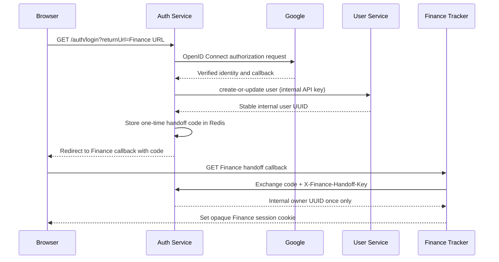

# Auth Service → Finance Tracker Integration

## Purpose

This document describes the implemented local authentication boundary between Auth Service, User Service, and Finance Tracker. It is intentionally more specific than generic SSO: it explains how a Google-authenticated person becomes an authorized owner of finance records.

## Responsibilities

| Service | Responsibility |
| --- | --- |
| Auth Service | Authenticates the browser with Google, owns the upstream Redis browser session, provisions the internal user, and issues a one-time Finance handoff code. |
| User Service | Owns the stable internal user UUID and role records. It accepts only authenticated service-to-service calls. |
| Finance Tracker | Exchanges the handoff code on its backend channel, creates its own opaque Finance session, and scopes every finance query to the internal user UUID. |

## Login and handoff flow

## Local service contract

The handoff uses two separate controls:

1. A one-time code stored in Auth Service Redis with a short lifetime. It identifies the already-provisioned internal user but is not itself an authenticated Finance session.
2. `X-Finance-Handoff-Key`, a shared local backend secret sent only by Finance Tracker to Auth Service when it exchanges the code.

Both services must receive the same `FINANCE_HANDOFF_SERVICE_KEY` value. This secret is local-development transport protection; it is never returned to a browser and must not be committed.

The User Service API uses a separate `USER_SERVICE_API_KEY`. Auth Service supplies it as `X-Internal-Api-Key` while provisioning the user.

## Session behavior

- Auth Service creates the upstream browser session in Redis after Google sign-in.
- Finance Tracker creates a separate opaque, server-side Finance session after successful handoff exchange.
- Finance Tracker does not accept a browser-supplied owner ID, raw Google ID token, or arbitrary user UUID.
- Signing out of Finance Tracker ends the Finance session. Auth Service logout separately invalidates its Redis session.

At present, logout is not coordinated across every relying application. That is deliberate follow-up work for a production SSO platform.

## Failure behavior

- User provisioning failure stops login instead of creating a partial authenticated state.
- Missing or incorrect service credentials reject the Finance exchange.
- Expired or already-consumed handoff codes reject the Finance exchange.
- Finance Tracker fails closed when it cannot establish a verified owner session.

## Production hardening still required

Before treating this as a production identity platform, replace the local shared service secret with signed, audience-restricted assertions validated with JWKS or mutually authenticated TLS; require HTTPS; add client registration and key rotation; define refresh and coordinated logout behavior; and emit security audit events without recording tokens or PII.
